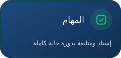
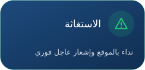
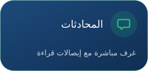
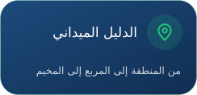
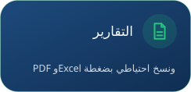
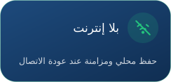

### منظومة الإدارة والمتابعة الميدانية

تطبيق أندرويد أصلي بالعربية يجمع الإدارة المركزية والمناطق والمربعات والمخيمات في لوحة واحدة: مهام، استغاثة، محادثات، وتقارير.

 

  

  
 
  

  

 &nbsp; 

 

بعد التثبيت الأول تصلك كل نسخة جديدة من داخل التطبيق تلقائيًا.

  

**تصميم وتطوير المهندس ساجد العبادلة**

 

  

© 2026 ساجد العبادلة — جميع الحقوق محفوظة

