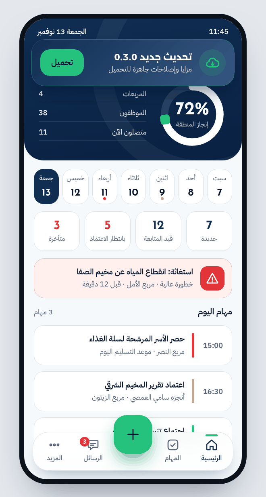
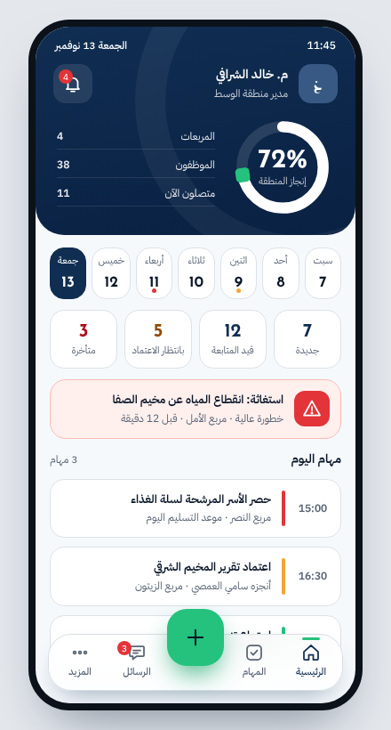
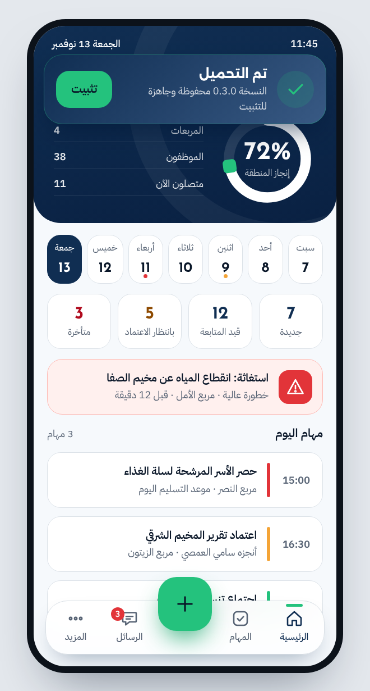
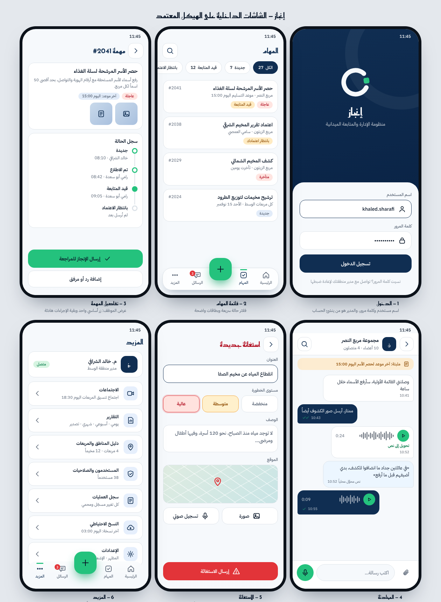
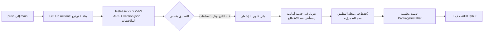
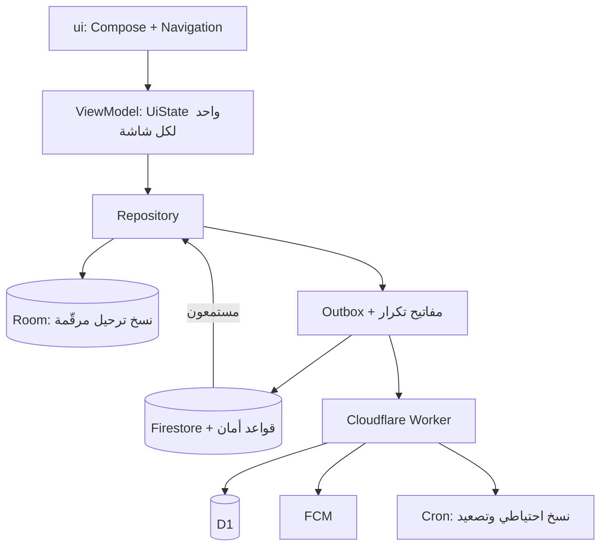

<div align="center">


# إنجاز

**منظومة الإدارة والمتابعة الميدانية** — تطبيق أندرويد أصلي بالعربية (RTL) يربط الإدارة المركزية بالمناطق والمربعات والمخيمات في لوحة واحدة.

[](https://github.com/Dev-saged/Anjaz/actions/workflows/build.yml)
[](https://github.com/Dev-saged/Anjaz/releases/latest)


<br>



<sub>التحديث الذاتي في إنجاز: بانر علوي ← تنزيل في الخلفية ← «تم التحميل» ← تثبيت بضغطة</sub>

</div>

---

## لماذا إنجاز

جمعية واحدة، مناطق ومربعات ومخيمات، وعشرات الفرق الميدانية. المطلوب شاشة واحدة تقول ما أُنجز وما تأخر وأين يحتاج الميدان مساعدة الآن، دون اعتماد على خدمات مدفوعة ودون تعقيد على المستخدم.

| | |
|---|---|
| **عمل بلا إنترنت** | كل شيء يُحفظ محليًا أولًا ويُزامَن عند عودة الاتصال، بمفتاح تكرار يمنع التكرار والتعارض |
| **خمس صلاحيات** | مركزي، مدير منطقة، مسؤول منطقة، مدير مربع، موظف ميداني، وكل شاشة تتكيف مع دور صاحبها |
| **مجاني بالكامل** | Firebase Spark + Cloudflare Workers/D1/Cron، بلا بطاقة ولا فواتير |
| **توزيع مباشر** | APK موقّع يُنشر تلقائيًا على GitHub Releases ويُحدّث نفسه من داخل التطبيق |

## الواجهة

<div align="center">

&nbsp;&nbsp;

</div>

<div align="center">

</div>

> اللقطات أعلاه معاينات مرسومة من نماذج التصميم المعتمدة (`brand/prototype`) بنفس الألوان والخطوط والمكوّنات المبنية في التطبيق، وليست التقاطًا من جهاز.

**لغة التصميم:** كحلي عميق ومرجاني أخضر، خط Alexandria للعناوين وIBM Plex Sans Arabic للنص، لوحة OKLCH تعمل في الفاتح والداكن، أرقام جدولية (`tnum`) معزولة LTR داخل النص العربي، لمسات حركة تحترم إعداد «إزالة الحركة»، وأيقونات مرسومة يدويًا بحجم 24dp وسُمك موحّد.

## المزايا

- **المهام** — إنشاء وإسناد ومتابعة، دورة حالة كاملة، سجل أحداث لكل مهمة، وأرقام تُحسب من سجل المعاملات لا من حقول قابلة للتعديل.
- **الاستغاثة SOS** — نداء بالموقع وبطاقة تنبيه عاجلة على الشاشة الرئيسية وإشعار مرتفع الأولوية يتجاوز «عدم الإزعاج».
- **المحادثات** — غرف ورسائل متزامنة مع إشعارات FCM وفتح مباشر على الغرفة من الإشعار.
- **الدليل الميداني** — منطقة ← مربع ← مخيم، تُدار من التطبيق وتُزامَن بالترتيب الصحيح.
- **الحسابات** — المدير ينشئ الحسابات ويحدّد الدور والنطاق، وتُولَّد كلمة مرور مؤقتة آمنة، دون بريد إلكتروني حقيقي للموظف.
- **التقارير** — PDF وExcel بتنسيق عربي سليم، ونسخ احتياطي JSON يُحفظ أيضًا داخل مجلد التطبيق، واستعادة بالدمج لا تمسح بيانات الجهاز.
- **سجل التدقيق** — من فعل ماذا ومتى، لمستوى مسؤول المنطقة فما فوق.
- **التحديث الذاتي** — تفصيله أدناه.

## التحديث الذاتي

كل `push` على `main` يبني التطبيق ويوقّعه وينشر **Release** جديدًا يحمل الـAPK وملف `version.json`، فيرى كل مستخدم التحديث داخل التطبيق دون أي خطوة يدوية.



- **ثلاث طبقات فحص مستقلة:** `version.json` ثم تحويل `releases/latest` ثم GitHub API، فلا يخفي حجبٌ أو حدّ طلبات النسخة الجديدة.
- **تنزيل لا يتوقف:** خدمة أمامية بإشعار نسبة، استئناف عبر `Range`، وإعادة محاولة بتأخير متدرج، ويستمر بعد إغلاق التطبيق.
- **جاهز وباقٍ:** النسخة المنزَّلة تُحفظ في مجلد التطبيق، فإن أغلق المستخدم التطبيق عاد إليها زرُّ «تثبيت» في البانر والإشعار.
- **تحقق قبل التثبيت:** لا يُعرض للتثبيت إلا ملف باسم الحزمة نفسه ورقم إصدار أحدث من المثبّت.
- **تنظيف:** يُحذف الـAPK فور استبدال الحزمة (`MY_PACKAGE_REPLACED`) وعند كل تشغيل كإجراء احتياطي.
- **ملاحظات الإصدار** تُقرأ من `docs/releases/vX.Y.Z.md` وتظهر في الورقة السفلية تحت «ما الجديد».

**مجلد التطبيق على الهاتف** `Android/data/com.anjaz.app/files/Anjaz/` ويضم `updates/` و`backups/` و`exports/`.

## المعمارية



- طبقات صارمة `ui → ViewModel → repository → data`، والأحداث تصعد والحالة تنزل، ولا منطق أعمال داخل الـComposables.
- **هندسة المخططات:** كل وحدة كائن مخطط صغير (حقول، صلاحيات، أعمدة، فلاتر) يرسمه محرك واحد عام للنماذج والقوائم والتفاصيل.
- **`BrandConfig.kt` هو المكان الوحيد** للاسم والألوان والعملة والإعدادات، وعميل جديد = تعديل هذا الملف فقط.
- الأرصدة تُشتق من معاملات تُضاف ولا تُعدَّل، والحذف ناعم.

## التقنيات

| الطبقة | الاختيار |
|---|---|
| اللغة والواجهة | Kotlin 2.2، Jetpack Compose، Material 3، Navigation Compose |
| الحقن | Hilt + KSP |
| البيانات المحلية | Room (مخطط v3، ترحيلات 1←2←3 مرقّمة)، DataStore |
| الخلفية | WorkManager، خدمة أمامية للتنزيل |
| السحابة | Firebase Auth + Firestore + FCM، وCloudflare Workers/D1/Cron |
| التسلسل | kotlinx.serialization |
| الاختبار | JUnit، Robolectric، 53 اختبار وحدة |
| البناء | Gradle، AGP 8.11، GitHub Actions |

الحد الأدنى Android 7.0 (API 24) والهدف API 36، بلا WebView.

## التثبيت

1. افتح [أحدث إصدار](https://github.com/Dev-saged/Anjaz/releases/latest) ونزّل ملف `Anjaz-v…apk`.
2. اسمح بـ«التثبيت من هذا المصدر» عند الطلب، ثم ثبّت.
3. سجّل الدخول بالحساب الذي أنشأه لك مديرك. بعد ذلك تصلك النسخ الجديدة من داخل التطبيق.

## البناء من المصدر

```bash
export ANDROID_HOME=/path/to/android-sdk
./gradlew testDebugUnitTest assembleDebug
```

ملفات الخادم في [`backend/`](backend/) (Worker وقواعد Firestore وسكربتات النشر) مع شرح الحالة في `backend/README.md`.

## النشر الآلي

`build.yml` يبني على كل push، وعلى `main` مع توقيع صحيح ينشر Release بالوسم `vX.Y.Z-bN`. يحتاج أربعة أسرار في Settings ← Secrets and variables ← Actions:

`KEYSTORE_BASE64` · `SIGNING_STORE_PASSWORD` · `SIGNING_KEY_ALIAS` · `SIGNING_KEY_PASSWORD`

رقم الإصدار الداخلي `versionCode = VERSION_CODE × 10000 + رقم البناء`، فيرتفع مع كل بناء ويقبله النظام ترقيةً. يجب أن تبقى شهادة التوقيع نفسها في كل الإصدارات.

## الأمان

- لا أسرار في الشيفرة ولا السجلات ولا رسائل الإيداع. إعداد Firebase العام وحده في المستودع، والصلاحيات الفعلية في **Security Rules** على الخادم، وفحوص العميل تجميلية فقط.
- تنظيف كل مُدخل، وبناء Release بـR8، وفصل صلاحيات الإدارة عن العميل عبر الـWorker.
- المفاتيح الخاصة (حساب الخدمة، رمز Cloudflare، شهادة التوقيع) لا تُرفع إلى هنا أبدًا.

## الحالة وخارطة الطريق

**منجز:** المهام، الاستغاثة، المحادثات النصية، الدليل، الحسابات، التقارير والنسخ الاحتياطي، التدقيق، التحديث الذاتي، والخادم منشور.

**قيد العمل:** وسائط المحادثات والمجموعات، تحويل الصوت إلى نص محليًا، الاجتماعات المرئية WebRTC، لوحات لكل دور، شاشة التصعيد، وشمول النسخ الاحتياطي في الـWorker للرسائل.

لم يُجرَّب التطبيق على جهاز حقيقي بعد، فالتحقق حتى الآن بالاختبارات الآلية والبناء الآلي.

## الهيكل

```
app/            تطبيق أندرويد (ui, data, sync, update, push, report, schema)
backend/        Cloudflare Worker + قواعد Firestore + سكربتات
brand/          الهوية: الشعار، الأيقونات، النماذج، أدوات التوليد
docs/           خريطة المستودع، ملاحظات الإصدارات، وسائط README
.github/        بناء ونشر وفهرسة الشيفرة آليًا
```

<div align="center">
<sub>صُنع لخدمة العمل الميداني — إنجاز</sub>
</div>
